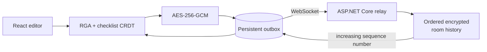

# SyncLab

[](https://github.com/EesherJ39/SyncLab/actions/workflows/ci.yml)

SyncLab is a collaborative editor that keeps working offline, merges everyone's changes on reconnect, and encrypts text before it leaves the browser.

Edits are merged with a CRDT, so two people can type at once, lose their connection and still end up with the same document. The relay server is a small ASP.NET Core WebSocket service, and it only ever sees ciphertext. I built the editor, wired in the CRDT, wrote the offline outbox that replays edits after a disconnect, and added AES-GCM encryption. I also fixed the out-of-order and duplicate-delivery handling and wrote the convergence and relay-ordering tests. There is a longer write-up with a live demo of the CRDT at [eesherj.com/projects/synclab](https://eesherj.com/projects/synclab).

## Why I built it

Real-time editors usually assume a steady connection. Real networks are messier: an insert can arrive before the text it depends on, a delete can arrive before the thing it deletes, and a reconnect can resend something the other side already has. I wanted an editor that handles all of those and still lets you keep typing with no connection at all.

## Run it

You need .NET 8+, Node.js 20+ and npm. Python 3.11+ is only needed for the stress and integration tests.

```bash
git clone https://github.com/EesherJ39/SyncLab.git
cd SyncLab
```

Start the relay in one terminal:

```bash
dotnet run --project backend/SyncLab.Server/SyncLab.Server.csproj
```

Start the client in another:

```bash
cd frontend
npm ci
npm run dev
```

Open the Vite URL, choose **Start demo room**, and open the copied link in a second browser profile. Use the network toggle to go offline, type in both windows, then reconnect and watch the queued edits replay. The status line under the editor shows how many changes are saved locally or waiting to sync.

## How it works



- **Every edit has an ID.** The document is an RGA-style CRDT, plus a second one for the checklist. Replicas remember which operation IDs they have applied, so a duplicate does nothing. Concurrent inserts at the same spot are ordered the same way on every replica.
- **Edits wait for what they depend on.** If an insert arrives before the character it follows, or a delete arrives before the insert it removes, it waits in a queue until the dependency shows up.
- **Editing keeps working offline.** Local edits apply immediately. Anything the server has not confirmed sits in an encrypted outbox in browser storage and is sent again on reconnect, even after a page refresh.
- **The server cannot read the document.** The room key lives in the URL fragment (the part after `#`), which browsers never send in HTTP or WebSocket requests. The relay stores and forwards ciphertext and IVs. It can still see room IDs, sender IDs, sequence numbers and timing, so the encryption protects the text but not that metadata.
- **Ordering is enforced on the server.** The relay reassembles fragmented WebSocket messages up to a size limit, serializes sends on each socket, and stamps every message in a room with an increasing sequence number. A simple broadcast loop gets each of those wrong under load.

## How I tested it

```bash
cd frontend
npm ci
npm test
npm run build

cd ..
python tests/fuzz_crdt.py

python -m pip install -r tests/requirements.txt
# Start the relay first; this one talks to it.
python tests/chaos_ws.py
```

- **CRDT unit tests** (`frontend/src/crdt/crdt.test.ts`) cover a child arriving before its parent, a delete arriving before its insert, checklist edits arriving before their item, duplicate delivery, and the same operations applied in different orders.
- **Convergence stress model** (`tests/fuzz_crdt.py`): 200 trials, each applying 250 operations across five replicas while temporarily dropping 20% of messages and duplicating 10%. It then redelivers everything in shuffled order and checks that all five replicas hold the same document. That is 250,000 replica-operation checks per run, all converged. It is a correctness test and says nothing about network latency.
- **WebSocket integration test** (`tests/chaos_ws.py`) has two clients send 100 messages each to the real relay, then checks that the sequence numbers come back in order with no duplicates.
- **Relay benchmark** (`tests/benchmark_ws.mjs`): four clients sent messages to one room and the relay broadcast each one to five connected clients. With 20,000 distinct messages (100,000 deliveries), no client missed a message, got a duplicate or saw one out of order, and the median of three trials was 369 ms. A smaller run of 4,000 messages (20,000 deliveries) had a median of 135 ms. Both ran on a Mac (Apple M3 Pro) with the server in Docker over localhost, so they measure the relay and not internet latency.

The benchmark method, every trial time and the raw JSON are in [`docs/WEBSOCKET_BENCHMARK.md`](docs/WEBSOCKET_BENCHMARK.md).

## Limitations

Room history lives in the relay's memory, so restarting the server loses it. Anyone with the room link can join and has the key. Each client keeps only its latest 5,000 events. Real use would need logins, durable append-only storage, key rotation, history compaction, rate limits, and more than one relay node.

The next step is authenticated membership and durable room history, then checking that the offline and convergence guarantees still hold once those are in place.

## Repo map

| Path | What it does |
|---|---|
| `frontend/src/crdt/crdt.ts` | creating and applying RGA and checklist operations, and holding ones that arrive early |
| `frontend/src/crdt/storage.ts` | browser history and the unconfirmed outbox |
| `frontend/src/crdt/crypto.ts` | key handling and AES-GCM encryption of operations |
| `frontend/src/ui/SyncStatus.tsx` | the sync status line under the editor |
| `backend/.../WsHub.cs` | fragmented-message assembly, send serialization and broadcasts |
| `backend/.../RoomStore.cs` | ordered, encrypted history for each room |
| `tests/fuzz_crdt.py` | multi-replica convergence stress model |
| `tests/chaos_ws.py` | WebSocket ordering and broadcast integration test |
| `tests/benchmark_ws.mjs` | relay throughput and delivery benchmark |
| `docs/WEBSOCKET_BENCHMARK.md` | benchmark setup, raw results and notes |
| `tools/oplog_analyzer/` | a small C++ tool for analyzing operation logs |
